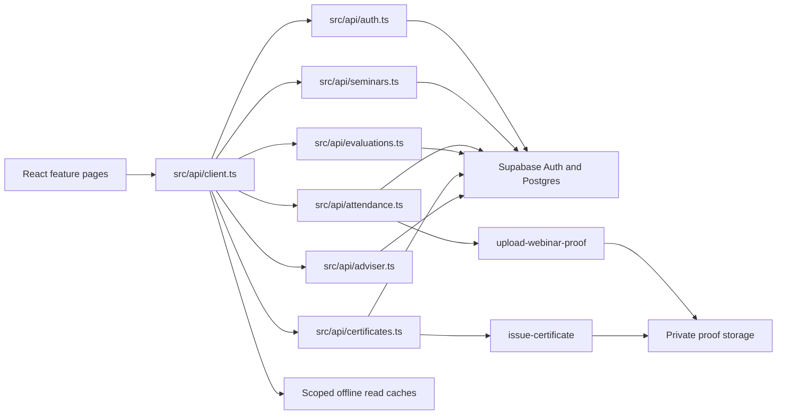

# Seminex codebase map

Snapshot date: 2026-11-12. This map describes the current workspace. It does not prove that uncommitted changes are merged or deployed. Hosted environment records and commands are in [Environment and deployment guide](ENVIRONMENTS.md).

The generated graph is in [Graphify](../graphify-out/GRAPH_REPORT.md). Open [graph.json](../graphify-out/graph.json) for extracted relationships, [graph.html](../graphify-out/graph.html) for the interactive view, and [seminex-callflow.html](../graphify-out/seminex-callflow.html) for call flows.

## System shape

Seminex is a Vite, React, TypeScript PWA. UI components call `src/api/client.ts`. API modules use Supabase Auth, Postgres, and Storage. Row Level Security and database functions enforce identity, access, and business rules. Edge Functions handle certificate rendering and webinar proof uploads. The app requires both public Supabase settings; missing or partial settings fail closed. Selected Supabase reads have browser-local offline caches. Mutations are not queued.

## Main modules

| Area | Main files | Responsibility |
| --- | --- | --- |
| App and access | `src/app/routes.tsx`, `RequireSession.tsx`, `RequireRole.tsx` | Routes, session bootstrap, and role checks. |
| API boundary | `src/api/client.ts`, `src/api/supabaseClient.ts` | UI API, Supabase client setup, and offline read fallbacks. |
| Authentication | `src/api/auth.ts`, `src/session/` | Student ID/email mapping, OTP, session identity, profile, and organization access. |
| Seminars | `src/api/seminars.ts`, `src/lib/seminarLifecycle.ts` | Catalog, registrations, drafts, covers, publishing, and lifecycle. |
| Attendance | `src/api/attendance.ts`, `supabase/functions/upload-webinar-proof/` | Attendance ledger, scanning, proof upload, and review. |
| Evaluation | `src/api/evaluations.ts`, `src/features/evaluation/` | Eligibility, survey versions, submissions, and organization analytics. |
| Certificates | `src/api/certificates.ts`, `supabase/functions/issue-certificate/` | Eligibility, serials, PDF rendering, and private downloads. |
| Adviser access | `src/api/adviser.ts`, `src/api/auth.ts` | Adviser queues, member directory, and membership changes. |
| Offline reads | `src/api/offlineCache.ts`, `src/api/orgOfflineCache.ts` | Scoped cached data for selected screens. |
| Database | `supabase/migrations/`, `supabase/tests/`, `supabase/seed.sql` | Schema, RLS, functions, SQL checks, and an empty local seed file. |
| Local database seed | `supabase/seed.sql` | Empty seed file; local resets create schema without demo rows. |

## Core flows

- Student signup derives `<StudentID>@gordoncollege.edu.ph` and verifies an email OTP. Supabase stores tokens; the UI API exposes safe identity fields.
- Registration, cancellation, confirmation, capacity, and expired-registration release are database-backed.
- Ticket data reads are scoped to the signed-in student's active registration and profile. Ticket PDFs are generated in the browser from that ticket, profile, and seminar data.
- Cover uploads use a public Storage bucket. Uploaded covers are readable before publication. Upload and deletion require an active officer and the matching unpublished draft.
- Attendance acknowledgement and scanner events use database functions and server time. QR payloads contain a short-lived, single-use challenge bound to one registration and seminar; Student ID is never encoded. Scanner writes use idempotency keys and require a connection.
- Webinar proof uploads pass through an Edge Function and private Storage. Review decisions are recorded in the attendance ledger.
- Evaluation and certificate eligibility use validated Time-Out and the seminar's `requiredAttendancePercent` (60% by default). Survey versions and responses are immutable.
- Certificate issuance and serial assignment are database-owned. The Edge Function stores PDFs privately. Eligible students and active organization members download PDFs through short-lived signed URLs. Certificates are delivered in-app only.
- Adviser management supports organization request queues, member directories, and membership changes.
- Lifecycle time uses the database clock. If the time request fails, time-dependent screens remain unavailable until a later server sample succeeds.

## Known gaps and limits

- Adviser certificate override requests and decisions are not connected. Supabase returns an empty `overrideRequests` array.
- Adviser queues and directories return arrays rather than paginated results.
- Hosted Auth OTP requires configured SMTP. Edge Function deployment state for staging and production is not verified in this workspace.
- Staging project reference, staging migration state, and frontend deployment are not verified. See [Environment and deployment guide](ENVIRONMENTS.md).
- The production migration and health details in that guide come from earlier user-provided evidence, not a live check.
- The user reports a local production database backup. Its contents and restore test are not verified here.
- The worktree contains unrelated modified and untracked files. This map does not say they are ready to push or deploy.
