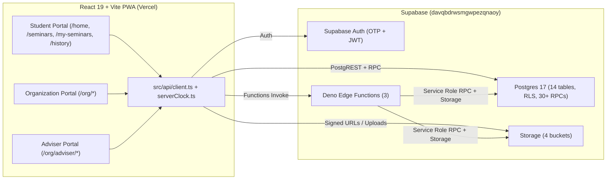

# Seminex Knowledge Base

> [!info] About This Vault
> This Obsidian vault replaces `graphify-out/` as the living architectural, schema, workflow, and API reference for **Seminex** — the Gordon College College of Computer Studies (CCS) seminar management, QR attendance, evaluation, and verifiable e-certificate platform.

## Maps of Content

### 1. Architecture & Operations
- [[System Overview]] — Tech stack, 3-portal design, data boundaries, and visual system
- [[Security & Access Control]] — Roles (`participant`, `org_member`, `adviser`), RLS, opaque QR challenges, and immutability guards
- [[Server Clock & Offline Strategy]] — Authoritative Postgres clock (`serverClock.ts`), monotonic progression, PWA caching, and offline stores
- [[Hosting & Deployment]] — Vercel SPA hosting, Supabase project (`davqbdrwsmgwpezqnaoy`), env vars, and Edge Function deploys

### 2. End-to-End Workflows
- [[Authentication & Onboarding]] — Student ID sign-in/up, Org officer access requests, Faculty Adviser sign-in
- [[Seminar Authoring & Publishing]] — 4-step editor (16:9 cover cropper, 16-font Certificate Designer, multi-page GForms Evaluation Builder, Publish)
- [[Registration & Attendance Flow]] — Registration, confirmation windows, 1-hour attendance prompt, live QR scanning, and webinar proof review
- [[Evaluation & Certificate Issuance]] — Multi-page anonymous evaluation submission, immediate Edge Function PDF rendering, and History download
- [[Adviser Governance Workflow]] — Officer approval queue, member roster management, read-only seminar oversight, and audit log exports

### 3. Database & Backend
- [[Schema & Tables]] — All 14 Postgres tables, `registration_read_model` view, ER diagram, and 4 Storage buckets
- [[RPC Functions & Triggers]] — Complete catalog of `public.*` and `private.*` SQL functions and triggers
- [[Migrations Timeline]] — Chronological index of all 21 Supabase migrations
- [[Edge Functions]] — `issue-certificate`, `regenerate-certificate`, `upload-webinar-proof`, and `_shared` helpers

### 4. Frontend Reference
- [[Routing & Portals]] — All routes across Public, Student, Organization, and Adviser portals
- [[API Client Reference]] — All 60+ `api.*` methods in `src/api/client.ts` and `ApiErrorCode` mapping
- [[Hooks, Session & UI System]] — Custom hooks, React context providers, shared components, and multi-format table exporter (`.csv`, `.md`, `.xlsx`)

---

## System Topology

