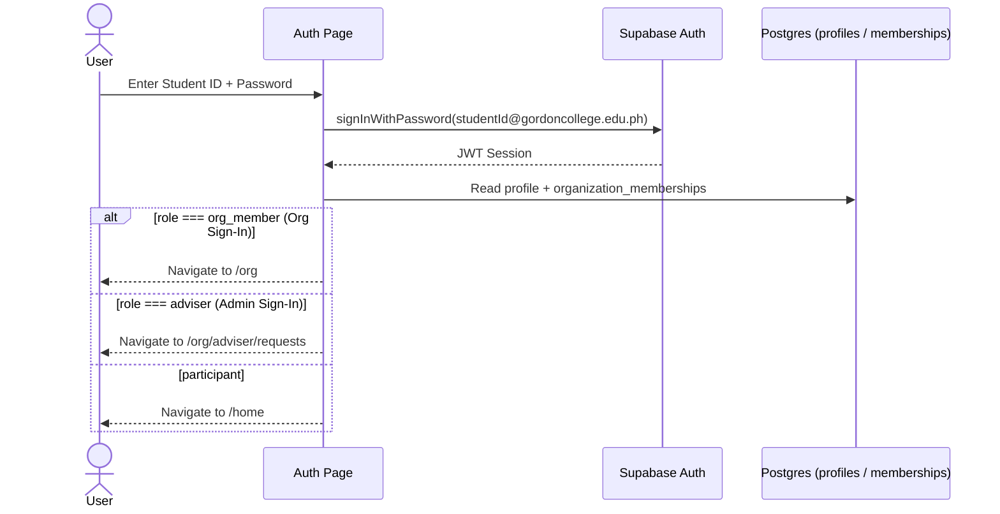

# Authentication & Onboarding

Back to [[Home]] | See also: [[Security & Access Control]], [[Routing & Portals]], [[API Client Reference]].

## Portal Entry Points

1. **Student Portal (`/sign-in`, `/sign-up`):**
   - Students sign in with their 9-digit Student ID (`20XXXXXXX`, mapped internally to `<studentId>@gordoncollege.edu.ph` in `src/api/auth.ts`) and password.
   - Sign-up is a 3-step horizontal flow (`StepProgress`): Institutional Email OTP verification (`OtpField`) → Student Details (Student ID, Name, Program CS/IT/EMC, Year 1–4, Block A–F) → Password setup (`PasswordRules`).
   - Database trigger `on_auth_user_created_or_email_changed` (`private.sync_auth_user_profile()`) creates/syncs `public.profiles`.

2. **Organization Portal (`/organization/sign-in`, `/organization/sign-up`):**
   - Strictly Student ID sign-in (`OrganizationSignInPage.tsx`, uniform with `SignInPage.tsx`).
   - `api.orgSignIn()` checks active membership in `public.organization_memberships`.
   - If the student has no active membership (`none` / `pending` / `rejected`), the UI offers direct links to `/home`, `/organization/request-access`, or `/organization/request-status`.
   - Officers requesting access call `public.complete_org_signup(...)` or submit an `organization_access_requests` row for [[Adviser Governance Workflow|Adviser approval]].

3. **Faculty Adviser Portal (`/admin/sign-in`):**
   - Faculty advisers sign in with their institutional email address and land directly on `/org/adviser/requests`.

4. **Password Recovery (`/forgot-password`):**
   - OTP-based flow: `api.sendPasswordResetOtp()` → `api.verifyPasswordResetOtp()` → `api.resetPassword()`.

