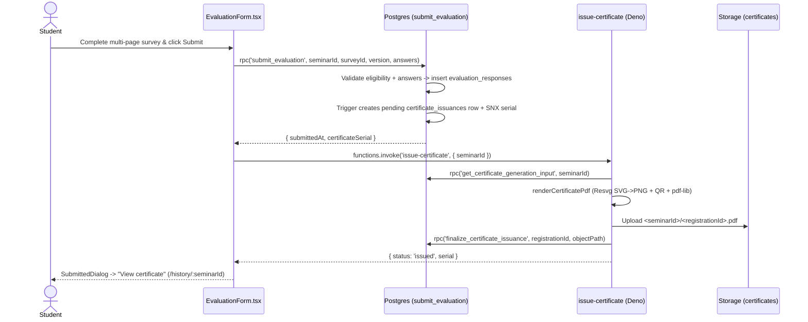

# Evaluation & Certificate Issuance

Back to [[Home]] | See also: [[Edge Functions]], [[Schema & Tables]], [[RPC Functions & Triggers]].

## End-to-End Flow

## Key Details

- **Multi-Page Survey Navigation (`EvaluationForm.tsx`):**
  - Paginates across `survey.sections` with per-section validation on `Next` and local draft persistence (`draftStore.ts`).
  - Uses distinct React keys (`next-section` vs `submit-evaluation`) + `isLastSection` guard so advancing pages never triggers accidental form submission.
- **Immediate Certificate Issuance (`src/api/evaluations.ts`):**
  - Immediately invokes `issue-certificate` right after `submit_evaluation` commits, captures the returned `serial`, and dispatches `seminex:registrations-changed`.
- **Viewing & Downloading (`HistorySummaryPage.tsx`, `src/api/certificates.ts`):**
  - `getCertificate(seminarId)` ensures issuance via `issue-certificate`, reads `object_path` via `get_my_certificate`, creates a 60s signed URL from the private `certificates` bucket, and returns the PDF `Blob` for inline preview and download.
- **Regeneration (`regenerate-certificate` Edge Function):**
  - Org officers can regenerate an issued certificate after updating a seminar's template; writes a new path `<seminarId>/<registrationId>/<requestId>.pdf` and records an audit row in `certificate_regeneration_audit`.
