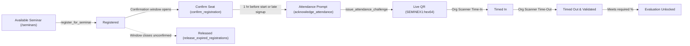

# Registration & Attendance Flow

Back to [[Home]] | See also: [[Server Clock & Offline Strategy]], [[RPC Functions & Triggers]], [[Edge Functions]].

## Lifecycle State Machine

## Key Behaviors

1. **Registration & Disappearance from Available Catalog:**
   - `AvailableSeminarsPage.tsx` filters out registered seminars immediately on registration (and restores them on Undo).
   - `SeminarDetailsPage.tsx` renders the live `TicketTab` directly when the student is registered and confirmed.
2. **Attendance Acknowledgement & Live QR (`AttendancePrompt.tsx`, `AttendanceQr.tsx`):**
   - At 1 hour before `startsAt` (or immediately on late signup), `AttendancePrompt` asks `"Still attending?"`.
   - `issue_attendance_challenge(p_seminar_id)` requires `attendance_ack_at IS NOT NULL`, writes an opaque 64-hex challenge to `private.registration_scan_challenges`, and sets expiry to `endsAt + 60m`.
3. **Org Check-In Scanner (`OrgScannerPage.tsx`):**
   - 2-column operational console with segmented `Time-In` / `Time-Out` toggle (defaults to `time_in`), `BarcodeDetector` + `jsQR` camera fallback, manual 9-digit Student ID fallback with optional reason, and idempotency keys.
   - Calls `record_org_challenge_scan` (QR) or `record_org_scan` (manual), appending an immutable row to `public.attendance_ledger`.
   - Displays a structured verification modal with mode/timestamp, student avatar/identity, and `Scan next attendee` CTA.
4. **Webinar Attendance Proofs (`upload-webinar-proof` Edge Function):**
   - For `seminarType === 'webinar'`, students upload PNG/JPEG screenshots via `upload-webinar-proof` → `webinar-proofs` bucket → `register_webinar_proof`, reviewed by org officers via `review_webinar_proof`.
5. **StudentPortal Home Transition (`OngoingSeminarCard.tsx`):**
   - Once `registration.timeOut?.validated` is `true`, the QR panel automatically switches to **Attendance confirmed → Complete evaluation** (and after evaluation submission, to **View certificate**).
