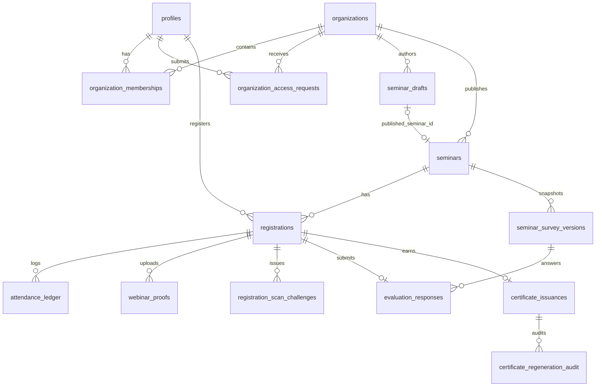

# Database Schema & Storage

Back to [[Home]] | See also: [[RPC Functions & Triggers]], [[Migrations Timeline]], [[Security & Access Control]].

## Entity-Relationship Overview

## Tables (14 Total)

| Schema.Table | Purpose | Key Invariants / Notes |
| --- | --- | --- |
| `public.profiles` | Student & adviser identity (`student_id`, `email`, names, `program`, `year_level`, `block`, `avatar_url`) | Synced from `auth.users` via `on_auth_user_created_or_email_changed` |
| `public.organizations` | Student organizations (e.g., CCS Student Council) | Referenced by memberships, drafts, and seminars |
| `public.organization_memberships` | Active/inactive officer & adviser memberships (`role`, `position`, `status`) | Governs `/org/*` and `/org/adviser/*` RLS |
| `public.organization_access_requests` | Pending/approved/rejected officer access applications | Decided by advisers via `decide_adviser_org_request` |
| `public.seminar_drafts` | Unpublished or in-edit seminar drafts (`details`, `certificate_template`, `survey`, `deletion_requested_at`) | Adviser read-only; publish guard prevents publishing during deletion |
| `public.seminars` | Published/archived seminars (`starts_at`, `ends_at`, `capacity`, `registered_count`, confirmation window minutes, `cover_image_url`) | `registered_count` maintained by trigger |
| `public.registrations` | Student registrations (`status`, `confirmed_at`, `attendance_ack_at`, `time_in_at`, `time_out_at`, `evaluation_submitted_at`) | One active registration per `(seminar_id, student_user_id)` |
| `public.attendance_ledger` | Immutable check-in / check-out event log (`kind`, `method`, `idempotency_key`, `reason`) | Append-only via `attendance_ledger_append_only` trigger |
| `public.webinar_proofs` | Screenshot proofs for webinar `time_in` / `time_out` (`object_path`, `status`, `review_reason`) | Uploaded via `upload-webinar-proof` Edge Function |
| `public.seminar_survey_versions` | Immutable published survey snapshots (`version`, `definition` JSONB) | Created by `seminar_drafts_snapshot_published_survey` trigger |
| `public.evaluation_responses` | Immutable student evaluation answers (`answers` JSONB, `submitted_at`) | Triggers `sync_evaluation_submitted_at` and `create_certificate_issuance` |
| `public.certificate_issuances` | Issued/pending certificates (`serial` `SNX-...`, `template_snapshot`, `status`, `object_path`, `issued_at`) | Finalized by `issue-certificate` Edge Function |
| `private.registration_scan_challenges` | Opaque 64-hex attendance QR tokens (`challenge`, `expires_at`, used state per mode) | Private schema — inaccessible to client queries |
| `public.certificate_regeneration_audit` | Audit trail for regenerated PDFs (`actor_user_id`, `request_id`, `previous_object_path`, `new_object_path`) | Service-role write only |

## Views (1 Total)
- `public.registration_read_model` (`security_invoker = true`): Projects student registrations with computed confirmation window state and attendance/evaluation timestamps.

## Storage Buckets (4 Total)

| Bucket ID | Public | Max Size | Allowed MIME Types | Purpose |
| --- | --- | --- | --- | --- |
| `seminar-covers` | `true` | 5 MB | `image/png`, `image/jpeg`, `image/webp` | 16:9 cropped seminar cover banners |
| `avatars` | `false` | 5 MB | `image/png`, `image/jpeg` | User profile photos (via signed URL / `set_my_avatar`) |
| `webinar-proofs` | `false` | 5 MB | `image/png`, `image/jpeg` | Student webinar attendance screenshots |
| `certificates` | `false` | — | `application/pdf` | Generated student e-certificate PDFs (60s signed URL download) |
